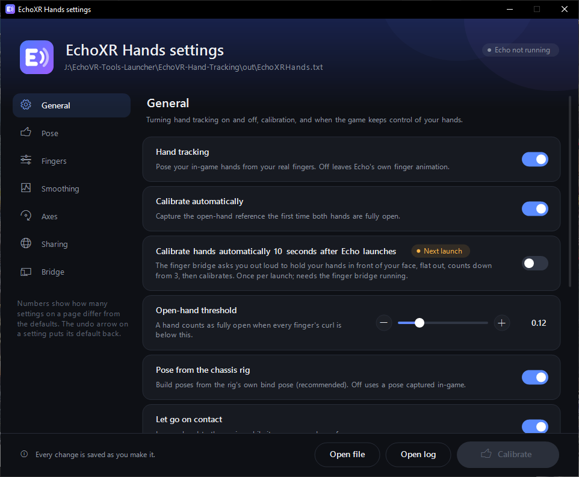
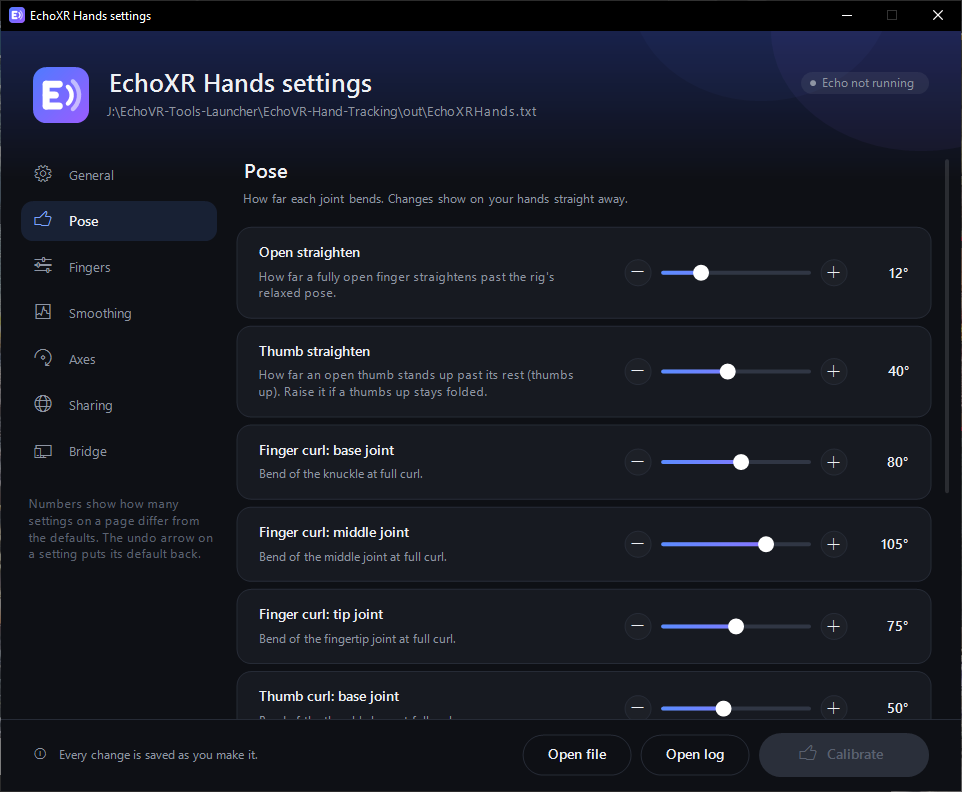

# EchoXR Hands

EchoXR Hands puts **your own fingers on Echo VR's chassis hands**: every finger
bends on its own, from Valve Index finger sensing or the SteamVR hand skeleton,
and other players running it see them too.

It works however you run Echo: through the Oculus / Meta runtime, or through
[EchoXR](https://github.com/heisthecat31/EchoXR) on SteamVR. It only needs Echo to
load plugins (see [Plugin loader](#plugin-loader)). With EchoXR, `EchoXR.exe`
installs it, runs it alongside Echo and keeps it updated.

Releases: [heisthecat31/EchoXR-Hands](https://github.com/heisthecat31/EchoXR-Hands/releases).

EchoXR Hands used to be called HandTrackingValve. The installer and the launcher
both migrate old installs.

## What it does

| | |
| --- | --- |
| **Your own fingers** | Every finger bends on its own, from the Index controllers' finger sensing (and can spread apart, with `SplayDeg`). Echo normally moves middle, ring and pinky together from the grip button. |
| **Other controllers and hand tracking** | On Touch, Vive, WMR and HP controllers, and on controller-free hand tracking that SteamVR presents as one of them, finger curls come from the hand skeleton instead. |
| **Other players' fingers** | The plugin sends your finger curls through a relay (`Network = 1`), and poses players who send theirs. |
| **Calibrate hotkey** | Ctrl+Alt+C recalibrates the open-hand pose at any time. |
| **Settings window** | `EchoXRSettings.exe` edits every setting, and the change shows in-game straight away. |
| **With EchoXR** | `EchoXR.exe` downloads hand tracking when it's switched on, runs the finger bridge alongside Echo and closes it afterwards, and offers updates. |

### Screenshots





The settings window writes each change to `EchoXRHands.txt` as you make it, and Echo
picks it up within half a second.

### What has been seen working

From the logs of real sessions on the current Echo build:

- **The plugin** hooks the game and finds the local player in a match. It receives
  the bridge's frames at about 120 Hz and calibrates.
- **Finger sharing:** the plugin connects to the relay, sends your fingers and
  poses other players' tracked fingers on their avatars (tested with other
  players running the plugin).
- **Quest hand tracking** through Virtual Desktop and SteamVR: every finger,
  thumbs up included. Virtual Desktop has to send real finger data to SteamVR;
  if SteamVR Home moves middle, ring and pinky together, the fingers are being
  emulated from grip and trigger, and Echo gets the same. The default settings
  were tuned on this setup.

### Not confirmed yet

- **Pose tuning.** The bend axis and direction are worked out from the rig
  automatically. If a finger bends the wrong way, the settings below fix it; see
  [First-run tuning](#first-run-tuning).
- **Finger spread** hasn't been checked in-game yet, so it's off by default
  (`SplayDeg = 0`). Try 10-20 on Index controllers.
- **Other controllers** (Vive, WMR, HP, real Touch controllers) haven't been
  tried. If fingers don't move, run `EchoXRHands.exe --print` and look at which
  source each hand uses.

### Limits

- **It changes how hands look, not what they do.** Grabbing still uses the game's
  own grip input.
- **Other players see your tracked fingers only if they run the plugin.**
  Everyone else sees the game's normal finger animation.
- **One game build.** The plugin's hooks are for the current `echovr.exe`
  (35,397,120 bytes, May 2023). It checks the bytes it changes first, and refuses
  anything else instead of breaking the game.
- **The finger bridge needs SteamVR.** Index controllers give the best result
  (real finger sensing, including spread). Other controllers only move the
  fingers their buttons can sense. Without any tracking you can still see other
  players' fingers; `fake_index.py` sends test input.

## Install

### With EchoXR

Set `AutoStartHands = 1` in `bin\win10\EchoXR\echoxr.ini` and run `EchoXR.exe`. It
downloads the latest `EchoXR-Hands-v*.zip` from this project's releases, installs
the plugin and the plugin loader, and runs the finger bridge alongside Echo. After
that it checks for a newer hand tracking release at most once a day and asks before
installing it (`CheckForUpdates = 0` turns that off).
`EchoXR\Hands\version.txt` records which release is installed.

The EchoXR installer (`EchoXRSetup.exe`) can also install hand tracking with
EchoXR, by switch.

### On its own

`EchoXR-Hands-v<version>.zip` unpacks into Echo's `bin\win10` folder, the one with
`echovr.exe`:

```
bin\win10\
  EchoXR\
    Hands\                    finger bridge (EchoXRHands.exe) and its SteamVR files,
                              settings window (EchoXRSettings.exe), version.txt
      install\                plugin, default settings, plugin loader
```

1. Unzip it into `bin\win10`.
2. Install SteamVR (free, on Steam): the finger bridge reads your fingers from it.
3. Run `EchoXR\Hands\EchoXRHands.exe`. Each start, it puts the plugin into
   `bin\win10\plugins\` and, if needed, the plugin loader, following the
   [loader rules](#plugin-loader). The old `HandTrackingValve.dll` is removed and
   its settings are kept. `EchoXRHands.exe --setup` does only this and exits.
4. Start Echo VR while the bridge is running.

### Plugin loader

The plugin is loaded by `dbgcore.dll`, a plugin loader that loads every DLL in
`bin\win10\plugins\`. The zip, `EchoXR.exe` and the installer apply the same rules
([`common/echoxr_common.h`](common/echoxr_common.h)):

| found in `bin\win10` | what happens |
| --- | --- |
| no `dbgcore.dll` | the loader is installed |
| the older 45 KB `dbgcore.dll` | the loader is installed, and the old file moves to `plugins\dbgcore_legacy.dll`, where it still loads |
| any other `dbgcore.dll`, with a `plugins\` folder | kept, since it's already a plugin loader; only the plugin is added |
| any other `dbgcore.dll`, no `plugins\` folder | left alone, and hand tracking isn't installed. The EchoXR installer replaces it only when you switch Plugin loader on, and saves the old file as `dbgcore.dll.bak`. |

## Using it

1. Start SteamVR.
2. Start the finger bridge: `EchoXR.exe` runs it for you (minimised) with
   `AutoStartHands = 1`; otherwise run `EchoXR\Hands\EchoXRHands.exe --print`.
3. In-game, hold both hands **fully open** once. That captures the reference pose:
   the game's relaxed pose becomes "curl = 0", and your relaxed finger spread
   becomes "no spread". To redo it at any time, hold your hands open and press
   **Ctrl+Alt+C**.

The bridge also takes commands:

```
EchoXRHands.exe --print                  stream and show the live curls
EchoXRHands.exe --calibrate              re-capture the open-hand reference
EchoXRHands.exe --set "BendAxis = x"     change a setting live
EchoXRHands.exe --ping                   check the plugin is loaded
EchoXRHands.exe --setup                  install the plugin and loader, then exit
```

Settings are in `plugins\EchoXRHands.txt`. The plugin re-reads it within half a
second, so you can edit it while you play. The bridge reads it when it starts.

The easy way to change them is `EchoXR\Hands\EchoXRSettings.exe`, the settings
window. It has every setting, grouped into pages, as switches, sliders and choices.
Each change is written to `EchoXRHands.txt` as you make it (a slider writes while you
drag), so with Echo running you see it on your hands within half a second. It only
rewrites the line that changed: your comments and ordering are kept. Settings that
need a restart (the bridge's, and `Platform`) are marked. The window also shows
whether Echo is running, has a **Calibrate** button (3-second countdown, so you can
get your hands open) and an undo arrow on every setting that differs from the
default. `EchoXRSettings.exe --file <path>` edits another copy of the file. With
EchoXR, `AutoStartSettings = 1` in `EchoXR\echoxr.ini` opens it alongside Echo.

| setting | what it does |
| --- | --- |
| `FingerSource = auto` | `device` = SteamVR's per-finger summary from the controller (Index finger sensing, with spread). `bones` = curls from the hand skeleton's joints, measured against SteamVR's open-hand pose (other controllers, controller-free hand tracking). `auto` = `device` on Index, `bones` on everything else. `--print` shows which each hand uses. With `bones`, each finger's zero is the straightest it has been this session, and Ctrl+Alt+C resets it to your hand as it is. |
| `SplayDeg = 0` | how far fingers spread per unit of Index splay, relative to your relaxed open hand. 0 = off; try 10-20 on Index |
| `ThumbStraighten = 40` | how far an open thumb stands up past its rest, per joint (thumbs up) |
| `CalibrateHotkey = 1` | Ctrl+Alt+C recalibrates; 0 frees the hotkey |
| `CalibrateOnLaunch = 0` | 1 = 10 seconds after Echo launches, the bridge says "Please hold your hands in front of your face, flat out", counts down 3-2-1 out loud (Windows text-to-speech) and calibrates, like Ctrl+Alt+C. Once per launch, and only for a fresh launch: restarting the bridge mid-game doesn't set it off. Read each time Echo starts. |

`Platform` and `PlatformAccount` are experimental, and empty (off) by default.
They change the platform prefix and account number of your login ID in memory at
startup (`pnsovr.dll`), and nothing on disk changes. Leave them off on EchoVRCE:
its server numbers platforms differently from the game, and it rejects the result.

### Why a separate bridge

Inside the game, SteamVR input belongs to the runtime, and a process gets exactly
one SteamVR action manifest. That manifest has no hand-skeleton actions. The bridge
is its own SteamVR overlay app, with a manifest that asks for both hand skeletons.
It sends frames to the plugin over `127.0.0.1:8768`.

### Finger sharing and privacy

With `Network = 1` (the default), the plugin connects to
`RelayUrl` (`wss://sparkapi-production-e6df.up.railway.app/htv/ws`). It sends:

- your finger curls, 30 times a second (`NetSendHz`);
- your display name;
- the names of the players in your match, so the relay can pair you with other
  players running the plugin.

The relay doesn't store anything. `Network = 0` keeps your tracking to yourself.

## First-run tuning

| symptom | fix |
| --- | --- |
| fingers don't move at all | check `plugins\EchoXRHands.log` for `hooked` and `receiving tracking frames`; then `TargetInstance` |
| someone else's hands move | the log lists instances; set `TargetInstance` to yours |
| fingers bend backwards | flip `LeftBendSign` / `RightBendSign` |
| fingers bend sideways or twist | set `BendAxis` to `x`, `y` or `z` (default `auto`) |
| left and right swapped | `GameHandLeft = 1` |
| wrong finger moves | set `FingerOrder` explicitly, e.g. `index,middle,ring,pinky,thumb` |
| thumb wrong | `ThumbBendAxis`, `LeftThumbSign` / `RightThumbSign` |
| shaky / laggy | lower `FilterMinCutoff` / raise `FilterBeta` |

## Logs

| log | what's in it |
| --- | --- |
| `plugins\EchoXRHands.log` | hooks, calibrations, finger order, hand-animator instances, relay status every 5 s |
| `EchoXR\launcher.log` | with EchoXR: hand tracking downloads and updates, the bridge starting and stopping |

## How the hand tracking works

Echo runs its frame as a table of gamespace tasks. Two belong to
`CR15HandAnimatorCS`, back to back:

| phase | task | address |
| --- | --- | --- |
| `0x6008` | `UpdateFingerAnimPoses` | `echovr+0x99f440` |
| `0x6009` | `UpdateThumbPistonAnimPoses` | `echovr+0x9a16e0`, **hooked** |

`UpdateFingerAnimPoses` only queues jobs (`echovr+0x99f830`, one per finger) for a
hand whose **contact** weight is non-zero. Those jobs wrap the fingers around
whatever the hand is touching. A hand touching nothing gets no jobs, so at
`0x6009` its animation is already written and nothing else is still working on it.
The hook poses those hands and then calls the original. Hands in contact are left
to the engine (`RespectContact = 1`).

Joints are read and written with the engine's own accessors:

- `get` `echovr+0x331bd0` returns `{quat xyzw, pos, scale}`.
- `set` `echovr+0x37c8c0` writes a joint **and carries its children along**.

Each finger is set proximal → middle → distal. Every joint gets its rest rotation
from the chassis rig (`UseRig = 1`), with a bend of `curl × MaxCurlN` degrees. The
game's grip animation is therefore **replaced**, not stacked on top.

Other players' fingers come in through the relay. They're applied in
`CR15RemotePlayerCS::UpdateCachePoseForPhysics` (`echovr+0xd77be0`, phase
`0x600c`), and `CR15NetGame::Update` finds who is in the match.

Every hooked function's first bytes are checked before hooking, and any mismatch
leaves the game untouched. A fault while posing turns the plugin off for the
session rather than crashing the game.

## Building

Everything builds with MSVC (Visual Studio 2026 toolset).

| command | builds |
| --- | --- |
| `build.bat` | `out\EchoXRHands.dll` (plugin), `out\EchoXRHands.exe` (bridge), `out\EchoXRSettings.exe` (settings window), default settings and SteamVR manifests |
| `python tools\make_release.py [--no-build]` | `out\release\EchoXR-Hands-v<VERSION>.zip`, the release asset `EchoXR.exe` downloads |
| `python tools\gen_rig_table.py` | `plugin\rig_table.h` from the chassis skeleton |

The version is in `VERSION`. Raise it for each release, and tag the release
`v<VERSION>`: `EchoXR.exe` offers an update when the latest release's tag is newer
than the installed `EchoXR\Hands\version.txt`.

Three inputs aren't committed, and live in ignored folders:

| file | what | where from |
| --- | --- | --- |
| `third_party\detours.lib` | Microsoft Detours (MIT), for the plugin's hooks | build it from [microsoft/Detours](https://github.com/microsoft/Detours) (x64) |
| `third_party\openvr_api.dll` | Valve's OpenVR library (BSD-3-Clause), shipped next to the bridge | `bin/win64` of [ValveSoftware/openvr](https://github.com/ValveSoftware/openvr) |
| `stage\dbgcore.dll` | the plugin loader, shipped in the zip | copied from an Echo install that has it; `make_release.py` takes it from `ECHO_BIN` when missing |

The [EchoXR](https://github.com/heisthecat31/EchoXR) installer bundles hand tracking
too. It expects this repository checked out next to it, as `EchoXR-Hands`, and runs
`build.bat` here.

| folder | what |
| --- | --- |
| `plugin/` | the plugin (hooks, posing, relay, Platform setting) |
| `bridge/` | finger bridge (SteamVR input → plugin, UDP `127.0.0.1:8768`) |
| `settings/` | settings window (edits `EchoXRHands.txt` live) |
| `common/` | shared with EchoXR, keep in step with its copies: `echoxr_common.h` (plugin and loader setup, from `xr/src/`) and `ui.h` (the UI kit, from `installer/`) |
| `third_party/` | Detours and OpenVR headers |
| `logo/` | the EchoXR logo, for the bridge and settings icons |
| `tools/` | release packaging, rig table generator, `fake_index.py` (test input) |
